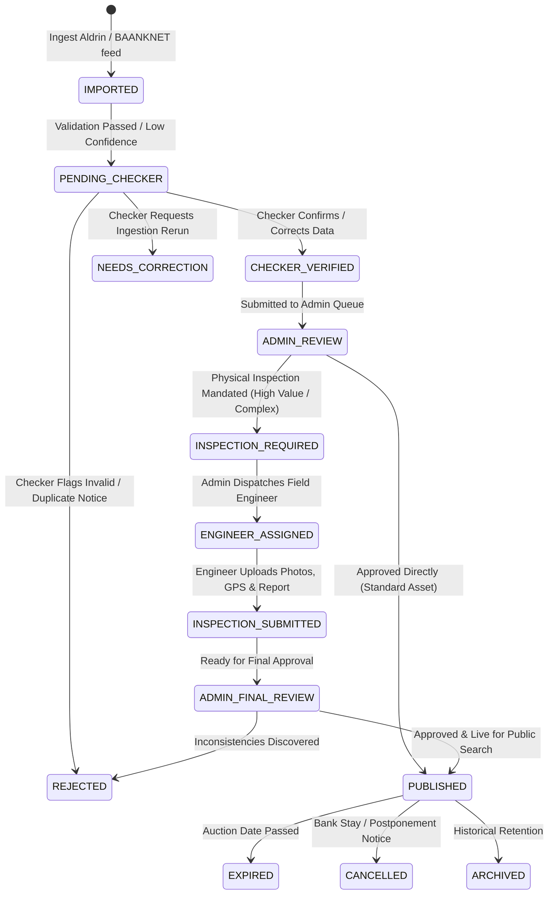

# BankAuctions.ai — Full Application Rebuild Architecture & Migration Blueprint

> **Prepared For:** Sajith Sir & Executive Engineering Review  
> **Author:** Lead Software Architect, Senior React & Node.js Developer, PostgreSQL Architect  
> **Date:** November 2026  
> **Status:** Phase 1 Architecture & Migration Specification (Signed Off)

---

## 1. Executive Summary & Architectural Decisions

BankAuctions.ai is being rebuilt from the ground up as a production-grade, enterprise-ready bank auction discovery and workflow platform. This platform bridges authentic legal auction notices published by lenders under the SARFAESI Act and DRT orders with prospective buyers, supported by a rigorous two-tier human verification and inspection pipeline.

### Core Architectural Decisions

1. **Clean Separation of Four Autonomous Panels:**
   - **Buyer Workspace:** Public discovery, category-specific filters, URL-synchronized search, AI rank breakdowns, saved properties, and account dashboards.
   - **Checker Workspace:** Side-by-side verification comparing original scanned notices (PDF/image) against extracted machine data, with field-level confidence badges, inline corrections, and rejection/escalation controls.
   - **Engineer Workspace:** Mobile-optimized physical inspection suite featuring GPS capture, photo uploads with canvas compression, discrepancy reporting, and market valuation estimates.
   - **Admin Control Plane:** Central authority overseeing data imports, checker exception queues, engineer assignments, publication approvals, user/staff RBAC, system telemetry, and tamper-evident audit logs.

2. **Technology Transformation (Spring Boot -> Node.js / Express):**
   - The legacy Spring Boot backend is migrated to an Express.js ES-modules backend.
   - Retains all domain entities, validation rules, status transition gates, and response shapes while offering superior real-time JSON handling and full stack synergy.
   - Zero TypeScript in compliance with strict requirements: clean, modern JavaScript ES6+ with JSDoc documentation, React 18 JSX functional components, and Zod runtime schema validation.

3. **PostgreSQL Relational + JSONB Hybrid Storage:**
   - Relational columns (`reserve_price`, `emd_amount`, `auction_date`, `city`, `bank_id`, `category_id`, `status`) indexed with B-Trees for rapid search queries.
   - JSONB columns (`attributes`, `maker_extracted`, `metadata`) for polymorphic category attributes (Flats, Houses, Plots, Shops, Offices, Warehouses, Vehicles/Machinery).

4. **Bespoke Visual Identity & Professional Glassmorphism:**
   - Deep Astral Navy (`#0B132B`, `#1C2541`) for financial authority.
   - Radiant Cyan / Emerald Accent (`#00E5FF`, `#10B981`) for verified badges, confidence scores, and primary actions.
   - Warm amber accents (`#F59E0B`) for critical auction deadlines.
   - Multi-layered frosted glass effects (`backdrop-blur-md`, specular white border highlights, subtle radial background glows) for high-end commercial elegance.

---

## 2. Prototype Inventory & Parity Mapping (All 32 Pages)

The 32 standalone HTML pages from Sajith's prototype have been exhaustively audited and mapped into the new modular React application:

| # | Prototype Page | New React Page / Route | Role / Panel | Functional Scope & Migration Plan | Target Backend API |
|---|---|---|---|---|---|
| 1 | `home.html` | `buyer/pages/HomePage.jsx` (`/`) | Public / Buyer | Hero banner with 5 featured verified auctions, AI search bar, category shortcuts, trust metrics, quick city filters. | `GET /api/v1/auctions/featured`, `GET /api/v1/categories` |
| 2 | `search.html` | `buyer/pages/SearchPage.jsx` (`/search`) | Public / Buyer | Faceted search with URL sync, category tabs, budget range, auction date closing, sorting, grid/list view, interactive SVG pin map. | `GET /api/v1/auctions`, `GET /api/v1/auctions/search-suggestions` |
| 3 | `flats.html` | `buyer/pages/CategoryPage.jsx` (`/category/flats`) | Public / Buyer | Specialized category view for Apartments/Flats rendering BHK, floor, super built-up area, society details. | `GET /api/v1/categories/flats/auctions` |
| 4 | `houses.html` | `buyer/pages/CategoryPage.jsx` (`/category/houses`) | Public / Buyer | Independent houses & villas: land area, built-up sq ft, floors, physical possession state. | `GET /api/v1/categories/houses/auctions` |
| 5 | `plots.html` | `buyer/pages/CategoryPage.jsx` (`/category/plots`) | Public / Buyer | Plots & land: plot number, survey number, road width, zoning/land use, boundaries. | `GET /api/v1/categories/plots/auctions` |
| 6 | `shops.html` | `buyer/pages/CategoryPage.jsx` (`/category/shops`) | Public / Buyer | Commercial shops & retail spaces: frontage, main road access, commercial score. | `GET /api/v1/categories/shops/auctions` |
| 7 | `offices.html` | `buyer/pages/CategoryPage.jsx` (`/category/offices`) | Public / Buyer | Office spaces & tech park units: lease status, floor plate, IT corridor tag. | `GET /api/v1/categories/offices/auctions` |
| 8 | `warehouses.html` | `buyer/pages/CategoryPage.jsx` (`/category/warehouses`) | Public / Buyer | Industrial sheds & warehouses: power sanctioned, NH highway frontage, container access. | `GET /api/v1/categories/warehouses/auctions` |
| 9 | `vehicles.html` | `buyer/pages/CategoryPage.jsx` (`/category/vehicles`) | Public / Buyer | Commercial vehicles & machinery: make, model, registration year, yard location. | `GET /api/v1/categories/vehicles/auctions` |
| 10 | `property.html` | `buyer/pages/PropertyDetailsPage.jsx` (`/property/:id`) | Public / Buyer | Comprehensive auction breakdown: reserve price, EMD, auction timing, bank notice link, field visit verification report, photos gallery. | `GET /api/v1/auctions/:id`, `POST /api/v1/analytics/view` |
| 11 | `account.html` | `buyer/pages/BuyerDashboardPage.jsx` (`/buyer/dashboard`) | Buyer | Buyer hub displaying active unlocked auctions, saved searches, plan status, receipt history. | `GET /api/v1/me`, `GET /api/v1/me/unlocked` |
| 12 | `archive.html` | `buyer/pages/SavedPropertiesPage.jsx` (`/buyer/saved`) | Buyer | Bookmarked auctions and persistent unlocked property dossiers with export capability. | `GET /api/v1/me/saved`, `DELETE /api/v1/me/saved/:id` |
| 13 | `preferences.html` | `buyer/pages/PreferencesPage.jsx` (`/buyer/preferences`) | Buyer | Search preference configuration: target cities, asset types, budget caps, alert subscriptions. | `GET/PUT /api/v1/me/preferences` |
| 14 | `pricing.html` | `buyer/pages/PricingPage.jsx` (`/pricing`) | Public / Buyer | Pro pack and membership tiers, feature comparison matrix, FAQs. | `GET /api/v1/config/plans` |
| 15 | `premium.html` | `buyer/pages/PricingPage.jsx` (`/premium`) | Public / Buyer | Premium city-specific curated highway & corner assets showcase. | `GET /api/v1/auctions/premium-preview` |
| 16 | `checker.html` | `checker/pages/VerificationQueuePage.jsx` (`/checker/queue`) | Checker | Exception queue with maker confidence score filter, city filter, reason categorization, claim/lock system. | `GET /api/v1/checker/queue`, `POST /api/v1/checker/claim/:id` |
| 17 | `review.html` | `checker/pages/SourceComparisonPage.jsx` (`/checker/reviews/:id`) | Checker | Split-screen interface: left side renders original notice PDF/image; right side provides field-by-field verification and correction. | `GET /api/v1/checker/reviews/:id`, `PATCH /api/v1/checker/reviews/:id` |
| 18 | `field.html` | `engineer/pages/MyAssignmentsPage.jsx` (`/engineer/assignments`) | Engineer | Field engineer dashboard: tasks categorized by To Visit, Scheduled, Submitted; city filter, KPI counters. | `GET /api/v1/engineer/assignments` |
| 19 | Inspection Flow | `engineer/pages/InspectionFormPage.jsx` (`/engineer/inspection/:id`) | Engineer | Field report submission: occupancy, road access, boundary match, GPS coordinates capture, 3+ photos upload with client-side compression. | `POST /api/v1/inspections/:id/submit` |
| 20 | `admin.html` | `admin/pages/AdminDashboardPage.jsx` (`/admin/dashboard`) | Admin | Central executive console: live properties count, exception queues, pending inspections, revenue/unlocks, audit activity feed. | `GET /api/v1/admin/overview`, `GET /api/v1/admin/kpis` |
| 21 | Admin Auctions | `admin/pages/AuctionManagementPage.jsx` (`/admin/auctions`) | Admin | Full auction lifecycle manager: view status, filter by bank/city, unpublish/republish, archive expired lots. | `GET /api/v1/admin/auctions`, `POST /api/v1/admin/auctions/:id/publish` |
| 22 | Admin Imports | `admin/pages/ImportManagementPage.jsx` (`/admin/imports`) | Admin | Upload structured JSON / CSV feeds from Aldrin/BAANKNET, run schema deduplication, view batch errors. | `POST /api/v1/imports/batch`, `GET /api/v1/imports/batches` |
| 23 | Admin Checkers | `admin/pages/CheckerManagementPage.jsx` (`/admin/checkers`) | Admin | Review checker velocity, assign urgent exceptions, view verification accuracy rates. | `GET /api/v1/admin/checkers` |
| 24 | Admin Engineers| `admin/pages/EngineerManagementPage.jsx` (`/admin/engineers`) | Admin | Assign properties to field engineers, track scheduled visit dates, monitor SLA completion. | `POST /api/v1/admin/engineers/assign` |
| 25 | Admin Approvals| `admin/pages/InspectionApprovalsPage.jsx` (`/admin/approvals`) | Admin | Dual-approval desk: inspect checker corrections and engineer physical reports before public publishing. | `POST /api/v1/admin/approvals/:id/approve` |
| 26 | Admin Staff | `admin/pages/StaffManagementPage.jsx` (`/admin/staff`) | Admin | Manage staff accounts, assign roles (CHECKER, ENGINEER, ADMIN), suspend/reinstate access. | `GET/POST /api/v1/admin/staff` |
| 27 | Admin Buyers | `admin/pages/BuyerManagementPage.jsx` (`/admin/buyers`) | Admin | Customer directory, plan management, unlock grant allocations, account security controls. | `GET /api/v1/admin/users`, `POST /api/v1/admin/users/:id/gift-unlocks` |
| 28 | Admin Audit | `admin/pages/AuditLogsPage.jsx` (`/admin/audit-logs`) | Admin | Immutable system audit log tracking who, when, and what changed across auctions and users. | `GET /api/v1/admin/audit-logs` |
| 29 | Admin Settings| `admin/pages/SettingsPage.jsx` (`/admin/settings`) | Admin | Site-wide announcement banners, Maker auto-publish threshold toggles, promo codes manager. | `GET/PUT /api/v1/admin/settings` |
| 30 | `data.html` | `buyer/pages/AiRankGuidePage.jsx` (`/data`) | Public | Deep dive into the 4-factor AI ranking algorithm: Discount (40%), Possession (25%), Location (20%), Documentation (15%). | Static + `GET /api/v1/analytics/rank-stats` |
| 31 | `learn.html` | `buyer/pages/GuidesPage.jsx` (`/learn`) | Public | Educational resource center explaining SARFAESI 13(4), EMD submission, DRT appeals, auction bidding mechanics. | Static educational resource |
| 32 | `staff.html` | `components/navigation/StaffPortalModal.jsx` (`/staff`) | Staff | Consolidated role-based staff authentication portal directing users to Checker, Engineer, or Admin workspaces. | `POST /api/v1/auth/staff-login` |

---

## 3. Canonical End-to-End Auction State Machine



---

## 4. PostgreSQL Relational Schema Design

```sql
-- 1. Identity & RBAC
CREATE TYPE user_role_enum AS ENUM ('BUYER', 'CHECKER', 'ENGINEER', 'ADMIN');
CREATE TYPE auction_status_enum AS ENUM (
  'IMPORTED', 'PENDING_CHECKER', 'CHECKER_VERIFIED', 'NEEDS_CORRECTION', 
  'ADMIN_REVIEW', 'INSPECTION_REQUIRED', 'ENGINEER_ASSIGNED', 
  'INSPECTION_SUBMITTED', 'ADMIN_FINAL_REVIEW', 'PUBLISHED', 
  'REJECTED', 'CANCELLED', 'EXPIRED', 'ARCHIVED'
);
CREATE TYPE possession_type_enum AS ENUM ('PHYSICAL', 'SYMBOLIC', 'CONSTRUCTIVE', 'UNKNOWN');

CREATE TABLE users (
    id UUID PRIMARY KEY DEFAULT gen_random_uuid(),
    email VARCHAR(255) UNIQUE NOT NULL,
    password_hash VARCHAR(255) NOT NULL,
    full_name VARCHAR(150) NOT NULL,
    phone VARCHAR(20) UNIQUE NOT NULL,
    role user_role_enum NOT NULL DEFAULT 'BUYER',
    plan_tier VARCHAR(50) DEFAULT 'FREE',
    unlocks_remaining INT DEFAULT 0,
    is_active BOOLEAN DEFAULT TRUE,
    created_at TIMESTAMPTZ DEFAULT NOW(),
    updated_at TIMESTAMPTZ DEFAULT NOW()
);

-- 2. Banks and Categories Reference
CREATE TABLE banks (
    id UUID PRIMARY KEY DEFAULT gen_random_uuid(),
    code VARCHAR(50) UNIQUE NOT NULL,
    name VARCHAR(255) NOT NULL,
    logo_url VARCHAR(500),
    contact_phone VARCHAR(50),
    created_at TIMESTAMPTZ DEFAULT NOW()
);

CREATE TABLE auction_categories (
    id UUID PRIMARY KEY DEFAULT gen_random_uuid(),
    code VARCHAR(50) UNIQUE NOT NULL,
    name VARCHAR(100) NOT NULL,
    slug VARCHAR(100) UNIQUE NOT NULL,
    icon VARCHAR(100),
    description TEXT,
    created_at TIMESTAMPTZ DEFAULT NOW()
);

-- 3. Core Auction Notices & Polymorphic Attributes
CREATE TABLE auction_notices (
    id UUID PRIMARY KEY DEFAULT gen_random_uuid(),
    source_ref VARCHAR(100) UNIQUE NOT NULL, -- e.g., BNK-CHE-47019
    source_link VARCHAR(1000),
    bank_id UUID REFERENCES banks(id),
    category_id UUID REFERENCES auction_categories(id),
    title VARCHAR(300) NOT NULL,
    short_title VARCHAR(150) NOT NULL,
    city VARCHAR(100) NOT NULL,
    locality VARCHAR(150) NOT NULL,
    address TEXT NOT NULL,
    pincode VARCHAR(20),
    reserve_price NUMERIC(15, 2) NOT NULL,
    estimated_market_value NUMERIC(15, 2),
    emd_amount NUMERIC(15, 2) NOT NULL,
    bid_increment NUMERIC(15, 2) DEFAULT 25000,
    auction_start_date TIMESTAMPTZ NOT NULL,
    auction_end_date TIMESTAMPTZ,
    notice_date DATE,
    inspection_date VARCHAR(200),
    possession possession_type_enum DEFAULT 'SYMBOLIC',
    encumbrances TEXT,
    contact_officer_name VARCHAR(150),
    contact_officer_phone VARCHAR(50),
    ai_score INT DEFAULT 70,
    ai_rank INT DEFAULT 1,
    ai_discount_pct NUMERIC(5,2),
    is_premium BOOLEAN DEFAULT FALSE,
    has_bank_photos BOOLEAN DEFAULT FALSE,
    featured BOOLEAN DEFAULT FALSE,
    primary_image_url VARCHAR(500),
    additional_images JSONB DEFAULT '[]',
    status auction_status_enum NOT NULL DEFAULT 'IMPORTED',
    claimed_by_checker_id UUID REFERENCES users(id),
    claimed_at TIMESTAMPTZ,
    created_at TIMESTAMPTZ DEFAULT NOW(),
    updated_at TIMESTAMPTZ DEFAULT NOW()
);

CREATE TABLE auction_attributes (
    id UUID PRIMARY KEY DEFAULT gen_random_uuid(),
    auction_id UUID REFERENCES auction_notices(id) ON DELETE CASCADE,
    attributes JSONB NOT NULL, -- Category-specific JSON (BHK, sqft, survey no, make/model, etc.)
    maker_extraction JSONB NOT NULL, -- Raw extracted fields with confidence values
    created_at TIMESTAMPTZ DEFAULT NOW(),
    updated_at TIMESTAMPTZ DEFAULT NOW()
);

-- 4. Verification Reviews & History
CREATE TABLE verification_reviews (
    id UUID PRIMARY KEY DEFAULT gen_random_uuid(),
    auction_id UUID REFERENCES auction_notices(id) ON DELETE CASCADE,
    checker_id UUID REFERENCES users(id),
    decision VARCHAR(50) NOT NULL, -- 'VERIFIED', 'CORRECTED', 'REJECTED'
    correction_notes TEXT,
    field_corrections JSONB DEFAULT '{}', -- Key-value diff of corrected fields
    review_duration_seconds INT,
    created_at TIMESTAMPTZ DEFAULT NOW()
);

-- 5. Field Inspections & Evidence
CREATE TABLE inspection_assignments (
    id UUID PRIMARY KEY DEFAULT gen_random_uuid(),
    auction_id UUID REFERENCES auction_notices(id) ON DELETE CASCADE,
    engineer_id UUID REFERENCES users(id),
    assigned_by_id UUID REFERENCES users(id),
    scheduled_date DATE,
    scheduled_slot VARCHAR(50),
    status VARCHAR(50) DEFAULT 'ASSIGNED', -- 'ASSIGNED', 'SCHEDULED', 'SUBMITTED', 'APPROVED'
    created_at TIMESTAMPTZ DEFAULT NOW(),
    updated_at TIMESTAMPTZ DEFAULT NOW()
);

CREATE TABLE inspection_reports (
    id UUID PRIMARY KEY DEFAULT gen_random_uuid(),
    assignment_id UUID REFERENCES inspection_assignments(id) ON DELETE CASCADE,
    occupancy_status VARCHAR(100),
    access_road_type VARCHAR(100),
    boundary_matches BOOLEAN,
    property_condition VARCHAR(100),
    utilities_observed JSONB DEFAULT '[]',
    litigation_observed TEXT,
    engineer_valuation_estimate NUMERIC(15, 2),
    engineer_notes TEXT,
    gps_coordinates VARCHAR(100),
    landmark_name VARCHAR(150),
    landmark_distance_km NUMERIC(6, 2),
    photos JSONB DEFAULT '[]', -- Array of uploaded image URLs
    submitted_at TIMESTAMPTZ DEFAULT NOW()
);

-- 6. Buyer Engagement & Audit Trails
CREATE TABLE saved_properties (
    id UUID PRIMARY KEY DEFAULT gen_random_uuid(),
    user_id UUID REFERENCES users(id) ON DELETE CASCADE,
    auction_id UUID REFERENCES auction_notices(id) ON DELETE CASCADE,
    saved_at TIMESTAMPTZ DEFAULT NOW(),
    UNIQUE(user_id, auction_id)
);

CREATE TABLE property_unlocks (
    id UUID PRIMARY KEY DEFAULT gen_random_uuid(),
    user_id UUID REFERENCES users(id) ON DELETE CASCADE,
    auction_id UUID REFERENCES auction_notices(id) ON DELETE CASCADE,
    unlocked_at TIMESTAMPTZ DEFAULT NOW(),
    UNIQUE(user_id, auction_id)
);

CREATE TABLE analytics_events (
    id UUID PRIMARY KEY DEFAULT gen_random_uuid(),
    event_type VARCHAR(100) NOT NULL, -- 'VIEW_AUCTION', 'SEARCH', 'UNLOCK', 'FILTER_CATEGORY'
    entity_id VARCHAR(100),
    user_id UUID REFERENCES users(id),
    metadata JSONB DEFAULT '{}',
    created_at TIMESTAMPTZ DEFAULT NOW()
);

CREATE TABLE audit_logs (
    id UUID PRIMARY KEY DEFAULT gen_random_uuid(),
    actor_id UUID REFERENCES users(id),
    actor_name VARCHAR(150),
    actor_role user_role_enum,
    action VARCHAR(150) NOT NULL,
    entity_type VARCHAR(100) NOT NULL,
    entity_id VARCHAR(100) NOT NULL,
    before_state JSONB,
    after_state JSONB,
    ip_address VARCHAR(50),
    created_at TIMESTAMPTZ DEFAULT NOW()
);
```

---

## 5. RESTful API Blueprint (`/api/v1`)

```
/api/v1/auth
  POST   /register                   Register new buyer account
  POST   /login                      User / Staff JWT authentication
  GET    /me                         Fetch active authenticated profile
  POST   /logout                     Clear authentication cookie

/api/v1/auctions
  GET    /                           Search published auctions (filters, sorting, pagination)
  GET    /featured                   Get up to 5 featured verified auctions
  GET    /stats                      Aggregate counts by city & category
  GET    /:id                        Get complete details for a single auction
  POST   /unlock/:id                 Use pack credit to unlock deep valuation & inspection dossier

/api/v1/categories
  GET    /                           List all 7 asset categories with auction counts
  GET    /:slug/auctions             Get listings filtered by specific category

/api/v1/me
  GET    /saved                      Get buyer's bookmarked auctions
  POST   /saved/:id                  Bookmark an auction
  DELETE /saved/:id                  Remove bookmark
  GET    /unlocked                   List buyer's permanently unlocked properties
  GET    /preferences                Get buyer alert & city preferences
  PUT    /preferences                Update preferences

/api/v1/checker
  GET    /queue                      Fetch pending exception records
  POST   /claim/:id                  Lock auction notice to prevent concurrent reviews
  GET    /reviews/:id                Fetch source notice & extracted fields for verification
  PATCH  /reviews/:id                Save edits and mark as CHECKER_VERIFIED or REJECTED
  GET    /history                    View verified history & audit metrics

/api/v1/engineer
  GET    /assignments                Get assigned field visit tasks (todo, scheduled, submitted)
  POST   /schedule/:id               Set planned site visit date & time
  POST   /inspections/:id/submit     Upload inspection findings, GPS coordinates, and photos
  DELETE /inspections/:id/withdraw   Withdraw submitted inspection for revisions

/api/v1/admin
  GET    /overview                   High-level metrics (active listings, queue sizes, revenue)
  GET    /auctions                   Manage all auctions across lifecycle states
  POST   /auctions/:id/publish       Approve and publish auction for public discovery
  POST   /auctions/:id/unpublish     Hide auction from public search
  GET    /imports                    List past batch ingestion runs
  POST   /imports/batch              Ingest raw JSON records from Aldrin / BAANKNET
  GET    /checkers                   Monitor checker productivity & queue sizes
  GET    /engineers                  Monitor field inspection status & assignments
  POST   /engineers/assign           Dispatch property to engineer
  POST   /approvals/:id              Dual approval gate (approve / reject verified record)
  GET    /users                      List registered buyers and staff accounts
  POST   /users/:id/gift-unlocks     Grant complimentary property unlocks
  GET    /analytics                  Platform search velocity, top-viewed assets, city trends
  GET    /audit-logs                 Immutable audit event stream
  GET    /settings                   Platform configuration & site banner announcement
  PUT    /settings                   Update configuration & toggles
```

---

## 6. Implementation Architecture & Directory Layout

```text
bankauctions-rebuild/
├── frontend/
│   ├── public/
│   │   ├── images/              <-- High-resolution South India asset photographs
│   │   ├── icons/               <-- Brand badges & vector marks
│   │   └── favicon.svg
│   ├── src/
│   │   ├── app/
│   │   │   ├── App.jsx          <-- App root & global shell
│   │   │   ├── routes.jsx       <-- Declarative role-based routing
│   │   │   └── providers.jsx    <-- TanStack Query & Auth Providers
│   │   ├── layouts/
│   │   │   ├── PublicLayout.jsx <-- Glassmorphic header, city selector, footer
│   │   │   ├── BuyerLayout.jsx  <-- Buyer account sidebar & activity dock
│   │   │   ├── CheckerLayout.jsx<-- Focused side-by-side verification topbar
│   │   │   ├── EngineerLayout.jsx<-- Mobile-first field engineer workflow bar
│   │   │   └── AdminLayout.jsx  <-- Command center sidebar, notifications, telemetry
│   │   ├── panels/
│   │   │   ├── buyer/           <-- 10 Buyer page components & widgets
│   │   │   ├── checker/         <-- 6 Checker verification components
│   │   │   ├── engineer/        <-- 7 Field engineer inspection components
│   │   │   └── admin/           <-- 13 Admin management components
│   │   ├── components/
│   │   │   ├── common/          <-- GlassCard, SpecularBadge, Button, Modal, Table
│   │   │   ├── forms/           <-- Input, Select, CurrencyInput, Slider, PhotoUpload
│   │   │   ├── navigation/      <-- Navbar, Sidebar, Breadcrumbs, StaffPortalModal
│   │   │   └── properties/      <-- PropertyCard, AiRankPill, CategoryBadge, MapView
│   │   ├── contexts/            <-- AuthContext, CityContext, FilterContext
│   │   ├── services/            <-- Axios / Fetch API client abstractions
│   │   └── styles/              <-- Tailwind & bespoke glassmorphic utility classes
│   ├── package.json
│   └── vite.config.js
│
├── backend/
│   ├── src/
│   │   ├── config/              <-- Environment, JWT secrets, database connection
│   │   ├── middleware/          <-- authMiddleware, roleGuard, errorHandler, rateLimiter
│   │   ├── modules/
│   │   │   ├── auth/            <-- Authentication controllers & JWT logic
│   │   │   ├── users/           <-- User and buyer profile management
│   │   │   ├── auctions/        <-- Core search, faceted filters, lot details
│   │   │   ├── categories/      <-- Category-specific attributes & schemas
│   │   │   ├── imports/         <-- BAANKNET / Aldrin data ingestion pipeline
│   │   │   ├── verification/    <-- Checker exception queue & diff engine
│   │   │   ├── inspections/     <-- Engineer assignment & report validator
│   │   │   ├── analytics/       <-- Privacy-safe telemetry & aggregations
│   │   │   └── admin/           <-- Dual-approval desk, RBAC & system settings
│   │   ├── routes/              <-- Express router assembly under /api/v1
│   │   ├── services/            <-- Reusable business logic services
│   │   ├── utils/               <-- Currency formatters, logger, deduplicator
│   │   ├── app.js               <-- Express configuration & middlewares
│   │   └── server.js            <-- HTTP listener
│   ├── prisma/
│   │   ├── schema.prisma        <-- Complete PostgreSQL schema
│   │   └── seed.js              <-- Real BAANKNET / Aldrin test records & staff accounts
│   └── package.json
│
├── shared/
│   ├── constants/               <-- Role definitions, auction states, categories
│   └── schemas/                 <-- Shared Zod validation schemas
│
├── docker-compose.yml           <-- Production PostgreSQL + Node service orchestration
├── .env.example                 <-- Standard configuration template
└── README.md                    <-- Comprehensive local setup & operation guide
```

---

## 7. Migration Verification & Acceptance Criteria

Every milestone must satisfy strict acceptance criteria:
1. **Zero TypeScript:** Every file strictly `.js` or `.jsx`.
2. **Authentic Data Provenance:** All 15–25 initial records link back to original BAANKNET notice references with real dates, reserve prices, and contact officer credentials.
3. **Four Independent Panels:** Distinct URLs, separate layouts, and backend-enforced role permissions.
4. **End-to-End Test Journey:** Data imported -> Verified by Checker -> Inspected by Engineer -> Approved by Admin -> Discovered by Buyer on public search.
